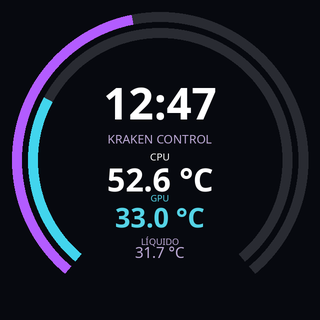
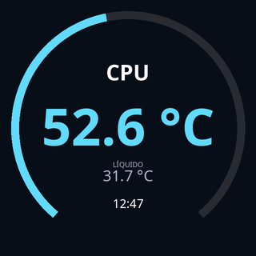
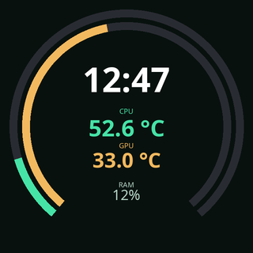

# Kraken Control for Ubuntu

A native GTK desktop app for NZXT Kraken Z liquid coolers: PC monitoring, pump/fan curves and a live LCD theme editor. The interface is currently in Spanish.

**Community project. Not affiliated with or endorsed by NZXT.** This is an early release tested on one Kraken Z-series device with an AMD Ryzen CPU and an NVIDIA GPU. Other hardware combinations need testing; please report your model, Ubuntu version and liquidctl version when opening an issue.

## Features

- CPU/GPU monitoring, RAM usage and DIMM temperatures when exposed by Linux, network rates, mounted storage and top processes.
- Independent pump/fan settings: fixed speed, quiet, performance and custom coolant-temperature curves.
- LCD orientation and brightness, CPU temperature, coolant temperature, static images and GIFs.
- Circular live theme preview, editable text/rings, colours, positions and backgrounds.
- Three themes: Nebula, Minimal and Aurora. Import/export editable JSON themes or export a 320 × 320 PNG.
- Optional startup profiles using systemd. Monitoring is unprivileged; changing the device requires desktop administrator authentication via pkexec.

| Nebula | Minimal | Aurora |
| --- | --- | --- |
|  |  |  |

These theme previews use **example readings**, not live telemetry from your computer.

## Compatibility

| Component | Status |
| --- | --- |
| NZXT Kraken Z53/Z63/Z73 family | Target family through liquidctl's `NZXT Kraken Z` matcher; only one Z-series unit tested |
| Other Kraken generations / RGB controllers | Not supported by this release |
| Linux hwmon `z53` sensor interface | Used for live coolant and RPM readings; missing kernel support means unavailable readings |
| AMD Ryzen temperature (`k10temp`) | Tested |
| Intel temperature (`coretemp`) | Implemented, untested |
| NVIDIA telemetry | Uses nvidia-smi; optional and read-only |
| AMD/Intel GPU telemetry | Not implemented; the rest of the app remains usable |
| Multiple Kraken coolers or multiple GPUs | Not supported; GPU index 0 is used |

The fan controls affect fans connected to the Kraken controller, not motherboard chassis fan headers. Curves use **coolant temperature**, not CPU temperature. Quiet/performance presets are this project's suggestions, not NZXT CAM presets.

## Install on Ubuntu

Ubuntu 24.04 or newer with a graphical desktop and systemd is the intended target. Hardware validation so far was on Ubuntu 26.04; The CI workflow is configured for Ubuntu 24.04; it does not replace physical hardware testing.

Install the system packages:

```bash
sudo apt update
sudo apt install python3-gi gir1.2-gtk-3.0 python3-cairo python3-pil python3-psutil liquidctl pkexec fonts-noto-core desktop-file-utils git
```

Then clone and install:

```bash
git clone https://github.com/magcuba/kraken-control.git
cd kraken-control
sudo bash install.sh
```

Open **Kraken Control** from Ubuntu's application menu. You can pin it to the dock. No terminal is required for normal use.

The installer copies the program to `/usr/local/lib/kraken-control` with root ownership and installs a desktop launcher. A fresh install **does not start the updater, enable it at boot or change pump/fan speeds**. Apply a screen or save a startup profile from the app when ready.

If you have the earlier custom `kraken-cpu.service` running, first stop and disable it before migrating:

```bash
sudo systemctl disable --now kraken-cpu.service
```

The installer refuses to run while that old updater is active. Do not run multiple applications that write to the cooler's USB device at the same time.

## Use

### Monitoring

Readings refresh about every three seconds. CPU load and network rates require two consecutive samples. Unavailable data is shown as unavailable instead of a fabricated value. Process CPU usage is expressed as a share of the entire machine, not a single core. Network rates are aggregate active-interface rates, not per-process traffic.

### Cooling

1. Open **Refrigeración**.
2. Check **Modificar ventiladores** and/or **Modificar bomba**.
3. Choose a profile or drag the curve points. Numeric inputs are also available.
4. Press **Aplicar refrigeración** to send the settings.

Moving controls only stages changes. Pump duty is limited to 20–100%. Monitor temperatures and actual RPM when testing a new profile; the app cannot guarantee that a preset suits every cooler or workload.

### Screen editor

1. Open **Pantalla LCD** and choose **Tema personalizable en vivo** under **Contenido**.
2. Pick a gallery theme or import a JSON file.
3. Select an element, change its source, text, size, colour and position, or drag it in the preview. Add/remove text and percentage rings as needed.
4. **Guardar tema** saves to the local gallery without touching the device.
5. **Aplicar pantalla** starts the live design until the next reboot. It continues running after closing the GUI.
6. **Guardar perfil al arrancar** applies and persists the screen and selected cooling channels.

A theme supports up to 16 elements. Text sources include clock, CPU/GPU/coolant temperature, CPU/GPU/RAM usage and pump/fan RPM. Rings use percentage sources. Missing readings are displayed as a dash.

Theme JSON is declarative data, not executable code. Version 1 examples are in [`themes/`](themes/). Imported JSON that references a background image needs that image at the specified path. When applying a theme, its background is copied for use by the system service.

## Files and service

- Program: `/usr/local/lib/kraken-control/`
- Command: `/usr/local/bin/kraken-control`
- Service: `kraken-control.service`
- Startup profile: `/etc/systemd/system/kraken-control.service.d/90-profile.conf`
- Temporary screen override: `/run/systemd/system/kraken-control.service.d/95-kraken-screen-preview.conf`
- Installed theme data: `/var/lib/kraken-control/themes/`
- Personal preferences: `~/.config/kraken-control/settings.json`
- Personal gallery: `~/.config/kraken-control/themes/`

Service logs are available in the app or with:

```bash
journalctl -u kraken-control.service -n 80 --no-pager
```

This project does not configure motherboard fans, modify BIOS settings, replace GPU drivers or diagnose unrelated operating-system crashes.

## Uninstall

From the source directory:

```bash
sudo bash uninstall.sh
```

This stops/disables the app's service and removes installed program/launcher files. Personal themes/preferences and `/var/lib/kraken-control` are kept. It does not reset the cooler's last pump/fan settings, which can persist while the device remains powered. An older `kraken-cpu.service` is not re-enabled automatically.

## Development and tests

With the Ubuntu dependencies installed:

```bash
/usr/bin/python3 -m unittest discover -v
/usr/bin/python3 app.py
```

Tests do not write to a physical cooler. They cover command validation, service generation and rollback, sensor/rate parsing, theme validation, image rendering and theme storage. The GitHub Actions workflow runs on Ubuntu 24.04. A successful unit test run does not replace checking authentication, rendering and device operation on a real Ubuntu desktop.

## Contributing

Bug reports and pull requests are welcome. Include your Ubuntu/kernel version, cooler model, liquidctl version and the exact error. Remove usernames, serial numbers, tokens and other personal data from logs before sharing them. Screenshots showing the relevant UI are useful.

## License and acknowledgements

MIT — see [LICENSE](LICENSE).

Device communication is performed by the separate [liquidctl project](https://github.com/liquidctl/liquidctl). GTK, PyGObject, Pillow, pycairo and psutil are system dependencies and retain their own licenses. Themes, artwork and code in this repository are original to this project. NZXT and Kraken are trademarks of their respective owners.

---

**Español:** instala las dependencias, ejecuta `sudo bash install.sh` y abre **Kraken Control** desde el menú de Ubuntu. En **Pantalla LCD → Tema personalizable en vivo** puedes editar temas. Guardar un tema lo añade a tu galería; solo **Aplicar** modifica el dispositivo. Esta versión es comunitaria y experimental: está probada en un solo equipo, no en todos los modelos NZXT.
